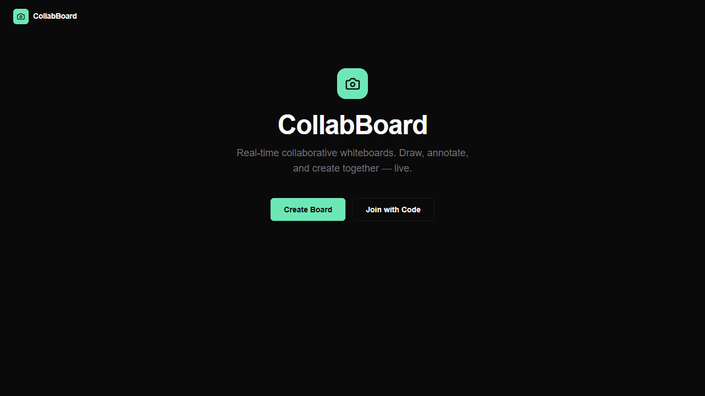
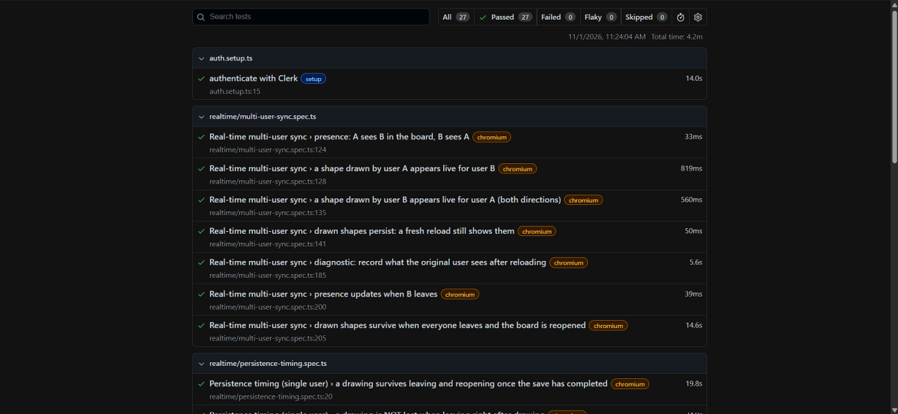
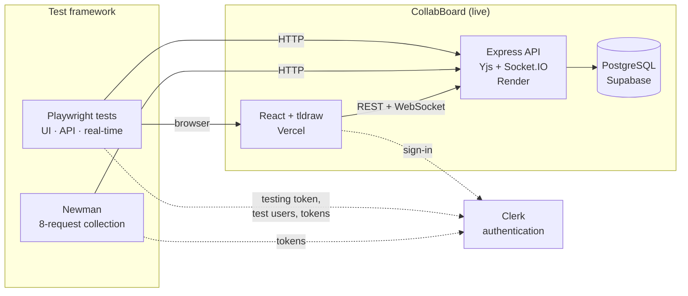
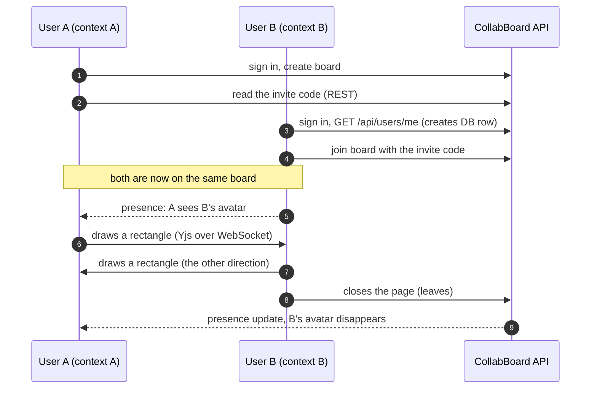
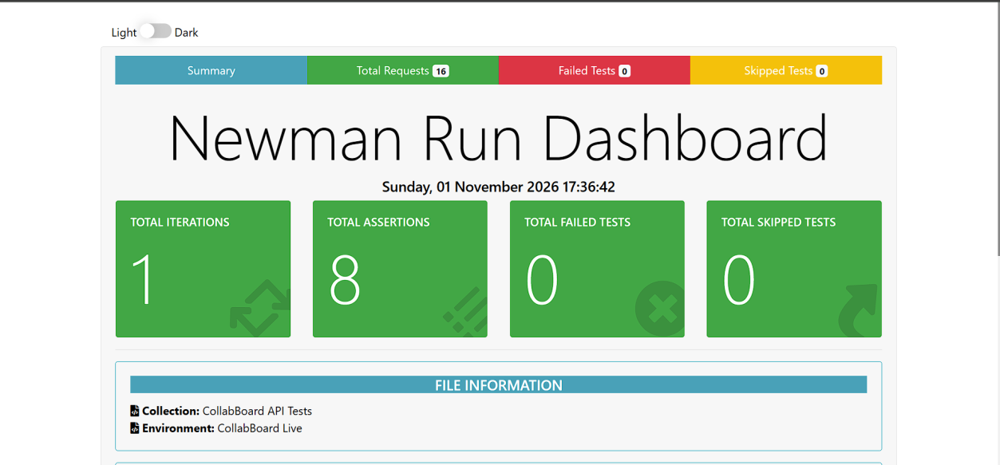
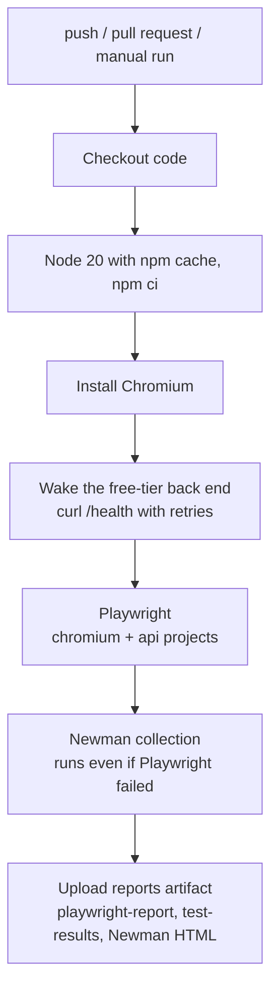
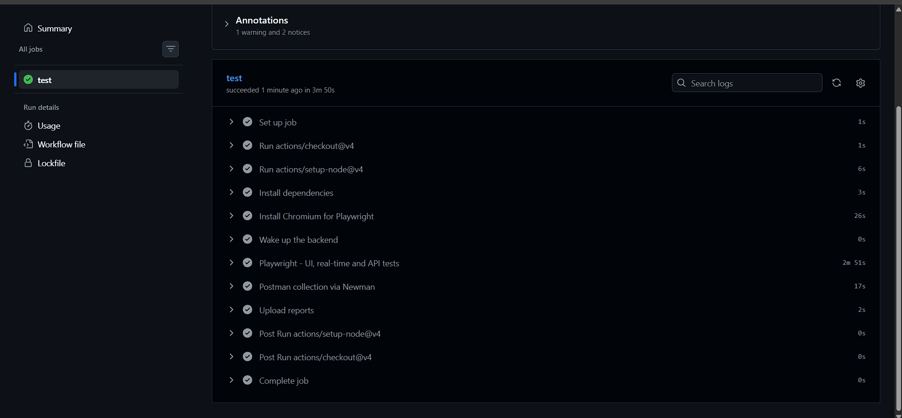
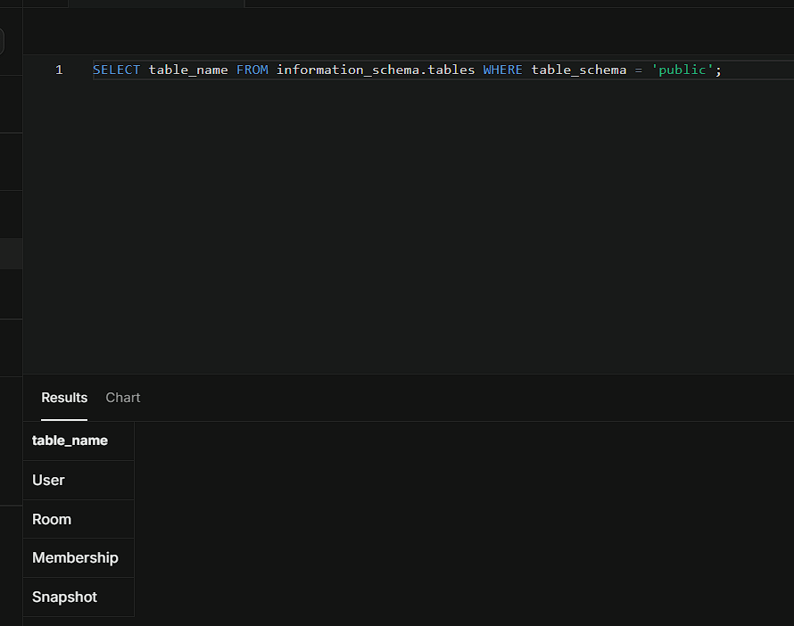

<div align="center">

# CollabBoard Test Automation

**A hybrid UI + API + real-time test framework for a live collaborative whiteboard**

Playwright · TypeScript · Postman/Newman · GitHub Actions

[](https://github.com/Hardikkhanduja/collabBoard-Testing/actions/workflows/playwright.yml)




</div>

---

## Overview

Most test projects automate a login form or a CRUD page with one user. **CollabBoard** is a
real-time application, where the real risk is *what happens when two people use the same board
at the same time*. This repository tests that, end to end, against the **live deployment**.

- **Two-user real-time tests**: two isolated browser contexts, signed in as two *different*
  users, join one board. Tests check presence and live drawing sync in **both directions**.
- **Real authentication**: Clerk testing mode (testing token and ticket sign-in), plus a fresh
  session token for every API call, because Clerk tokens expire in about 60 seconds.
- **Two independent API suites**: 14 Playwright API tests and an 8-request Newman collection.
- **Honest defect handling**: known defects are kept visible as expected-failure tests, so the
  suite stays green while the defect is documented, and Playwright warns when one gets fixed.
- **Unattended execution**: GitHub Actions runs everything on every push and keeps the reports.

> Built as the major project for **Software Testing** (5th semester, B.E. Computer Science &
> Engineering, Chandigarh University) by **Hardik Khanduja** (UID 24BCS10885).

## At a glance

| | |
| --- | --- |
| **Playwright tests** | 27 (1 setup, 3 UI, 14 API, 7 real-time, 2 persistence) |
| **Newman requests** | 8 (each preceded by a token request) |
| **Requirements covered** | 9 of 9 |
| **Final local run** | **27 passed, 0 failed, 0 flaky, 4.2 minutes** |
| **Expected-failure tests** | 3, each one a documented defect |
| **CI** | Playwright 2m51s + Newman 17s, run #3 green |
| **Defects found** | 3 application issues (DEF-01, DEF-02, DEF-03) and 1 infrastructure incident |

> **Reading the 27/27 correctly.** Playwright counts a test marked `test.fail()` as *passed*
> when it fails in the documented way. So 24 tests pass normally and 3 are known defects that
> fail as expected. See [Defects found](#defects-found).

<div align="center">

</div>

## Quick start

```bash
git clone https://github.com/Hardikkhanduja/collabBoard-Testing.git
cd collabBoard-Testing
npm ci
npx playwright install chromium
cp .env.example .env                      # Windows: copy .env.example .env  (then fill in your values)
npx playwright test --project=chromium --project=api
npx playwright show-report
```

You need your own Clerk test keys and a test account; see [Configuration](#configuration).

## Table of contents

- [Architecture](#architecture)
- [The two-user real-time test](#the-two-user-real-time-test)
- [What is tested](#what-is-tested)
- [Project structure](#project-structure)
- [Configuration](#configuration)
- [Running the tests](#running-the-tests)
- [Postman / Newman](#postman--newman)
- [Continuous integration](#continuous-integration)
- [Defects found](#defects-found)
- [Design decisions](#design-decisions)
- [Limitations](#limitations)
- [Troubleshooting](#troubleshooting)
- [Security](#security)
- [License](#license)

## Architecture

The system under test is a React/tldraw front end, an Express API with Yjs (canvas sync) and
Socket.IO (presence), PostgreSQL, and Clerk for sign-in. The framework tests it from the outside
through the browser and through HTTP.



The framework has four layers: tests, page objects, utilities and the runner configuration.

<div align="center">

</div>

| Playwright project | Purpose |
| --- | --- |
| `setup` | Signs in once and saves the browser session and Clerk session id to `.auth/` |
| `chromium` | UI and real-time tests, starting from the saved session |
| `api` | HTTP tests without a browser |

`firefox` and `webkit` projects are defined in `playwright.config.ts` but were not run.

## The two-user real-time test

CollabBoard counts presence **per user id**, so two windows of one account look like one person.
The suite therefore creates a **second Clerk user** through the Clerk Backend API and gives each
user its own browser context, like two separate laptops.



Sync is eventual, so tests never use fixed sleeps. They poll a condition until it is true:

```ts
await a.board.drawRectangle(400, 300);
await b.board.waitForShapeCount(base + 1);   // polls until the shape appears for user B
```

## What is tested

| Test cases | Layer | What they check |
| --- | --- | --- |
| TC-01 | Setup | Clerk sign-in; browser session and session id saved |
| TC-02 to TC-04 | UI | Create a board, rename it (survives reload), delete it |
| TC-05 to TC-18 | API | Missing or invalid token (401), create (201), empty name (400), list, join by invite code, bogus code (404), rename, canvas save and read-back, delete, health, user profile |
| TC-19 to TC-25 | Real-time | Presence, A→B sync, B→A sync, shapes stay in a shared session (DEF-03), reload diagnostic, presence when B leaves, reopen after everyone leaves (DEF-02) |
| TC-26 to TC-27 | Persistence | A drawing survives once the app's own save completes; a drawing made right before leaving is lost (DEF-02) |
| TC-API-01 to 08 | Newman | Health, no token, create, empty name, join, bogus code, rename, delete |

<details>
<summary><b>Full test catalogue</b></summary>

| ID | Layer | Test | Expected |
| --- | --- | --- | --- |
| TC-01 | Setup | Sign in the Clerk test user and save the session | Session file created |
| TC-02 | UI | Create a board from the dashboard | Board opens, canvas visible |
| TC-03 | UI | Rename a board; name survives reload | New name shown after reload |
| TC-04 | UI | Delete a board | Board removed from the list |
| TC-05 | API | Protected endpoint, no token | 401 |
| TC-06 | API | Protected endpoint, invalid token | 401 |
| TC-07 | API | Create room with a valid name | 201, id and invite code |
| TC-08 | API | Create room with an empty name | 400 |
| TC-09 | API | List the user's rooms | Created room present |
| TC-10 | API | Owner joins own room again | 200, same room |
| TC-11 | API | Join with a non-existent code | 404 |
| TC-12 | API | Owner renames a room | 200, new name |
| TC-13 | API | Save a canvas snapshot and read it back | Same snapshot |
| TC-14 | API | Delete a room, then access it | 403 or 404 |
| TC-15 | API | Health endpoint | 200 |
| TC-16 | API | `GET /api/users/me` without token | 401 |
| TC-17 | API | `GET /api/users/me` with valid token | Profile |
| TC-18 | API | Join with an invalid code | 4xx |
| TC-19 | Real-time | B joins; A sees B in the presence list | B's avatar visible |
| TC-20 | Real-time | A draws; B sees it | B's shape count increases |
| TC-21 | Real-time | B draws; A sees it | A's shape count increases |
| TC-22 | Real-time | Shapes stay on both canvases in a two-user session | Expected failure (DEF-03) |
| TC-23 | Real-time | Diagnostic: A's count before and after reload | Counts recorded |
| TC-24 | Real-time | B leaves; A's presence list updates | B's avatar disappears |
| TC-25 | Real-time | Draw, close both pages, reopen | Expected failure (DEF-02) |
| TC-26 | Persistence | Wait for the app's save, leave, reopen | 1 shape after reopen |
| TC-27 | Persistence | Draw and leave immediately, reopen | Expected failure (DEF-02) |

</details>

## Project structure

```
collabBoard-Testing/
├── .github/workflows/playwright.yml    CI: Playwright + Newman + report artifacts
├── docs/                               Screenshots and diagrams used in this README
├── pages/                              Page Object Model
│   ├── HomePage.ts                     Dashboard: create, join, delete boards
│   └── BoardPage.ts                    Canvas: rename, draw, presence, shape count
├── utils/
│   ├── clerkToken.ts                   Fresh Clerk session token for API tests
│   └── clerkUsers.ts                   Creates the second test user through Clerk
├── tests/
│   ├── auth.setup.ts                   Sign in once, save session  (TC-01)
│   ├── ui/board-management.spec.ts     TC-02 to TC-04
│   ├── api/                            TC-05 to TC-18  (rooms.spec.ts, api-basic.spec.ts)
│   └── realtime/
│       ├── multi-user-sync.spec.ts     TC-19 to TC-25  (two users)
│       └── persistence-timing.spec.ts  TC-26 to TC-27
├── postman/
│   ├── build-collection.js             Generates the Newman collection
│   └── collabboard.postman_collection.json
├── playwright.config.ts
├── .env.example                        Template for your local .env
├── package.json
└── tsconfig.json
```

## Configuration

**Prerequisites:** Node.js 20+, Git, a [Clerk](https://clerk.com) application used by the
deployed site (test-mode keys), and one test account created by signing up once on the live site.

Copy `.env.example` to `.env` and fill it in:

| Variable | Meaning |
| --- | --- |
| `BASE_URL` | Front-end URL of the deployed app |
| `API_URL` | Back-end URL |
| `CLERK_PUBLISHABLE_KEY`, `CLERK_SECRET_KEY` | Keys of the *same* Clerk app the site uses (test mode) |
| `TEST_USER_EMAIL` | Email of your dedicated test account |
| `TEST_USER2_EMAIL` | Optional second user; created automatically if empty |

`.env` is git-ignored. Never commit real keys.

## Running the tests

| Goal | Command |
| --- | --- |
| Everything (about 4 minutes) | `npx playwright test --project=chromium --project=api` |
| API tests only | `npx playwright test --project=api` |
| Real-time tests only | `npx playwright test tests/realtime --project=chromium` |
| **Watch the browser** (two windows open) | `npx playwright test tests/realtime/multi-user-sync.spec.ts --project=chromium --headed` |
| Step through with the inspector | `npx playwright test --project=chromium --debug` |
| Visual test runner | `npx playwright test --ui` |
| One test by title | `npx playwright test -g "creates a room" --project=api` |
| List all tests without running | `npx playwright test --list` |
| Open the HTML report | `npx playwright show-report` |

**About `--no-deps`.** Every project depends on `setup`, so Playwright signs in first. If you ran
setup moments ago and want to skip it, add `--no-deps`. To refresh the saved session:
`npx playwright test --project=setup`.

> The free Render back end sleeps when idle, so the first request can take up to a minute. Open
> `<API_URL>/health` in a browser before a demo to wake it.

Every failure leaves evidence: a trace, a screenshot and a video in `test-results/`
(open a trace with `npx playwright show-trace <trace.zip>`).

## Postman / Newman

The 8-request collection is generated by `postman/build-collection.js`. A collection-level
pre-request script fetches a fresh Clerk token before every request, and later requests reuse the
room id and invite code stored by earlier ones.

```bash
node postman/build-collection.js     # writes the collection; creates a placeholder environment file once
```

<details open>
<summary><b>Windows PowerShell</b></summary>

```powershell
npx playwright test --project=setup
$sid = node -p "require('./.auth/token.json').sessionId"
$sk  = (Select-String -Path .env -Pattern '^CLERK_SECRET_KEY=(.*)$').Matches[0].Groups[1].Value
npx -y -p newman -p newman-reporter-htmlextra newman run postman/collabboard.postman_collection.json `
  -e postman/collabboard.postman_environment.json `
  --env-var "sessionId=$sid" --env-var "clerkSecretKey=$sk" `
  -r cli,htmlextra --reporter-htmlextra-export postman/report.html
```

</details>

<details>
<summary><b>macOS / Linux</b></summary>

```bash
set -a; . ./.env; set +a
SESSION_ID=$(node -p "require('./.auth/token.json').sessionId")
npx -y -p newman -p newman-reporter-htmlextra newman run postman/collabboard.postman_collection.json \
  -e postman/collabboard.postman_environment.json \
  --env-var "sessionId=$SESSION_ID" --env-var "clerkSecretKey=$CLERK_SECRET_KEY" \
  -r cli,htmlextra --reporter-htmlextra-export postman/report.html
```

</details>

<div align="center">

</div>

Newman reports 16 requests because each of the 8 requests is preceded by a token request.

## Continuous integration

`.github/workflows/playwright.yml` runs on every push, pull request and on demand.



A concurrency group stops two runs from overlapping on the same shared app. To run the pipeline
in your own fork, add these **repository secrets** (Settings, Secrets and variables, Actions):
`CLERK_PUBLISHABLE_KEY`, `CLERK_SECRET_KEY`, `TEST_USER_EMAIL`, `TEST_USER2_EMAIL`.

<div align="center">

</div>

| Run | Result | Cause and fix |
| --- | --- | --- |
| #1 | Failed (2m58s) | Secret `TEST_USER2_EMAIL` was missing, so the second user could not be created. Added the secret. |
| #2 | Failed (4m43s) | The rename UI test was flaky on a cold server; an empty secret slipped past `??`; an expected-failure test that passed on retry was reported as an error. Raised the timeout, used `\|\|`. |
| #3 | **Green (3m50s)** | All fixes applied. Playwright 2m51s, Newman 17s. |

## Defects found

| ID | Finding | Severity | Status |
| --- | --- | --- | --- |
| **DEF-01** | A brand-new user's first join by invite code fails with `401 "User not found"`. The app creates the database row in a background `GET /api/users/me` that can finish after the join. | Medium | Reproduced, cause known |
| **DEF-02** | Canvas edits are lost if the user leaves within about 2 seconds of drawing. The debounced save timer is cleared when the board unmounts (TC-25, TC-27). | High | Reproduced, cause known |
| **DEF-03** | Shapes drawn in a two-user session sometimes disappear (TC-22). Inconsistent between runs. | High if confirmed | Observed in automated runs; cause **not established** |
| **INC-01** | The API returned 500 on every request after the free Render database expired. | Incident | Resolved: migrated to Supabase |

DEF-02 and DEF-03 are kept as `test.fail()` tests. If one of them starts to pass, Playwright
reports an error, which means the defect was fixed and the marker can be removed. TC-22 records
evidence (shape count every 0.5 s for 4 s, screenshots, the saved snapshot) so the cause can be
investigated.

<div align="center">

</div>

## Design decisions

| Decision | Reason |
| --- | --- |
| Playwright over Selenium or Cypress | Isolated browser contexts make two simultaneous users straightforward; API testing and the trace viewer are built in |
| Page Object Model | Selectors live in `pages/`; tests read as behaviour and survive UI changes |
| Clerk testing mode with ticket sign-in | Real sign-in screens use email codes and bot protection, which cannot be automated reliably |
| Fresh token per API call | Clerk session tokens expire in about 60 seconds |
| Polling instead of sleeping | Real-time sync is eventual; waiting for a condition is faster and more reliable than a fixed delay |
| One worker | The free-tier back end has a small database connection pool; the tests should test the app, not the hosting limits |
| `test.fail()` for known defects | Keeps defects visible and signals when they are fixed |
| Retries only in CI | Absorb network hiccups in CI while showing real failures locally |

## Limitations

- Only Chromium was run; Firefox and WebKit are configured but not run.
- Tests run against the live deployment on free hosting, so timing varies between runs.
- Coverage is *designed* coverage (requirements to tests); the application code is not instrumented.
- `test.fail()` accepts any failure, so the evidence recorded by each test must be read to confirm
  the failure reason.
- Most boards created by the tests are not deleted afterwards.
- No performance or security testing.

## Troubleshooting

| Problem | Fix |
| --- | --- |
| First test is slow or times out | The free Render server was asleep. Open `<API_URL>/health`, wait, run again. |
| API tests return 401 | The saved session is stale. Run `npx playwright test --project=setup`. |
| Newman shows 401 or `PASTE_SESSION_ID_HERE` | Pass `sessionId` and `clerkSecretKey` with `--env-var`, as shown above. |
| `Cannot find module '../../utils/clerkUsers'` in the editor | Restart the TypeScript server in VS Code. |
| "Signed in, but could not read a session token" | Check that the Clerk keys belong to the same Clerk app as the live site, and that `TEST_USER_EMAIL` is a real account on it. |

## Security

- Secrets live only in `.env` (local) and GitHub Actions secrets (CI). `.env`, `.auth/` and the
  Newman environment file are git-ignored.
- Test users use `+clerk_test@example.com` addresses. Use Clerk **test-mode** keys only.
- The tests do not load-test or scan the hosted services.

## License

[MIT](LICENSE) © 2026 Hardik Khanduja